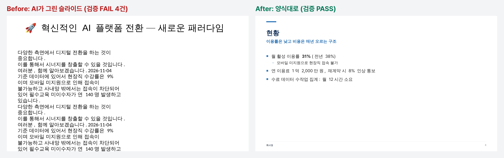
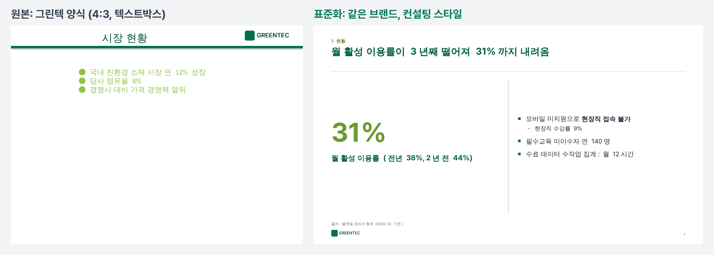

# 양식대로 (yangsik)

> **우리 회사 양식 그대로, 고칠 수 있는 파일로, 한글이 안 깨지게.**
> Claude가 Word·PowerPoint 문서를 만들 때 쓰는 한국어 스킬입니다.



---

## 1. 이게 뭔가요

AI에게 PPT를 맡기면 이런 일이 생깁니다.

- 회사 양식을 무시하고 새 상자를 덧그립니다 → 결국 다시 옮겨 붙입니다
- 결과가 그림이라 한 글자도 못 고칩니다
- 한글이 단어 중간에서 끊기고, 글이 상자 밖으로 넘칩니다
- "혁신적인 시너지를 창출하는 것이 중요합니다" 같은 AI 말투가 남습니다

**양식대로**는 세 가지로 이 문제를 막습니다.

| | 하는 일 |
|---|---|
| **채우기** | 양식을 새로 그리지 않고, 양식의 '칸'에 내용만 넣습니다. 결과는 100% 편집 가능한 .pptx / .docx |
| **컨설팅 스타일** | PPT는 전략 컨설팅 덱 관례대로: 제목 = 결론 문장(액션 타이틀), 12단 그리드, 정해진 글자 크기, 출처 필수, 내용은 자동으로 세로 균형 |
| **검증** | 만들 때마다 자동 검사: 양식 밖 상자, 한글 글꼴, 글 넘침, 개조식 문체, AI 말투 → PASS / WARN / FAIL |
| **표준화** | 회사 양식에서 **색·글꼴·로고를 뽑아 표준 양식 10종을 그 브랜드로 새로 만듭니다.** 원본을 그대로 쓰고 싶으면 진단(A/B/C)·정리 후 등록 |

회사 양식이 없어도 됩니다. **용도별 표준 양식 10종**이 들어 있습니다.

---

## 2. 이런 분께 맞아요 / 안 맞아요

**맞아요**
- 보고서·품의서·회의록·제안서·발표자료를 자주 만드는 직장인
- 회사 양식이 정해져 있어서 AI 결과물을 매번 옮겨 붙이는 분
- 팀장님 피드백을 받아 "3번 장만" 고치고 싶은 분

**안 맞아요**
- 매번 새롭고 화려한 디자인이 필요하다 → Gamma 같은 디자인 생성 도구가 낫습니다
- HWP(한글) 파일이 꼭 필요하다 → 아직 미지원 (v2 예정)
- 엑셀 → 아직 미지원

---

## 3. 5분 설치

### 방법 ① claude.ai / Claude 데스크톱 앱 (코딩 몰라도 됨)

1. [최신 Release](https://github.com/jch2100/document/releases/latest)에서 **`yangsik-버전.zip`** 을 받습니다 (압축 풀지 마세요)
2. claude.ai → **설정 → 기능(Capabilities)** → **코드 실행 및 파일 생성**을 켭니다
3. 같은 화면 **스킬(Skills)** → **스킬 업로드** → `yangsik.zip` 선택
4. 새 대화에서: *"양식대로 스킬로 1페이지 보고서 만들어줘"*

> 유료 플랜(Pro·Max·Team·Enterprise)에서 됩니다. 메뉴 이름은 앱 버전에 따라 조금 다를 수 있습니다.
> 회사 계정이면 관리자가 스킬 기능을 막아 두었을 수 있습니다.

### 방법 ② Claude Code

```bash
git clone https://github.com/jch2100/document.git
```
```bash
mkdir -p ~/.claude/skills && cp -r document/yangsik ~/.claude/skills/yangsik
```
```bash
pip install -r ~/.claude/skills/yangsik/requirements.txt
```

자세한 내용·문제 해결: [INSTALL.md](INSTALL.md)

---

## 4. 바로 해보기 (복붙 프롬프트)

스킬을 올린 뒤 새 대화에 그대로 붙여 넣으세요.

**① 1페이지 보고서 (Word)**
```
양식대로 스킬로 1페이지 보고서를 만들어줘.
내용: 사내 교육 플랫폼 계약이 12월에 끝남. 재계약하면 8% 인상.
B사로 바꾸면 연 7,800만 원, 모바일 지원, 6주면 전환. 11월 20일까지 승인 필요.
```

**② 경영진 보고 PPT**
```
위 내용을 경영진 보고 PPT 7장으로 만들어줘. 대안 비교표 넣어줘.
```

**③ 피드백 반영**
```
팀장님 피드백: "3장 결론이 약하다, 이용률 추이 그래프 추가해줘". 해당 부분만 고쳐줘.
```

---

## 5. 기본 양식 10종

회사 양식이 없으면 Claude가 용도에 맞게 고릅니다. 이름으로 지정해도 됩니다 ("품의서 양식으로").

| PPT | 언제 | Word | 언제 |
|---|---|---|---|
| [경영진 보고](yangsik/templates/pptx/01-exec-report/preview.png) | 결정을 받을 때 | [1페이지 보고서](yangsik/templates/docx/01-1page-report/preview.png) | 한 장으로 보고 |
| [제안·영업](yangsik/templates/pptx/02-proposal-sales/preview.png) | 고객 설득 | [기획서·품의서](yangsik/templates/docx/02-plan-approval/preview.png) | 예산·실행 승인 (결재란 포함) |
| [프로젝트 계획](yangsik/templates/pptx/03-project-plan/preview.png) | 킥오프·R&R 합의 | [결과보고서](yangsik/templates/docx/03-result-report/preview.png) | 끝난 일 보고 |
| [성과 발표](yangsik/templates/pptx/04-performance/preview.png) | 실적·KPI | [제안서](yangsik/templates/docx/04-proposal/preview.png) | 서술형 제출 문서 |
| [교육·워크숍](yangsik/templates/pptx/05-training/preview.png) | 강의 | [회의록](yangsik/templates/docx/05-minutes/preview.png) | 결정·할 일 기록 |

- 모든 양식: 한글 글꼴(맑은 고딕) 지정, 어절 단위 줄바꿈, 개조식 자동 기호(□ ○ -), 제목 자동 번호(1. 가. 1))
- PPT 레이아웃 14종: 표지·목차·섹션·요약(3단카드)·빅넘버·차트+시사점·표·2단비교·2x2 매트릭스·프로세스·본문·핵심메시지·이미지·마무리
- PPT 디자인 규칙(글자 크기·그리드·정렬): [design-system.md](yangsik/references/design-system.md)
- **우리 회사 색으로**: *"우리 회사 색(#0050A0)과 회사명으로 양식 10종 바꿔줘"* → 10종이 한 번에 바뀝니다

예시 결과물: [PPT](docs/images/example-pptx.png) · [Word](docs/images/example-docx.png) · [examples/](examples/)

---

## 6. 우리 회사 양식으로 바꾸기

**① 브랜드 표준화 (권장)** — 회사 양식이 엉망이어도 됩니다
```
첨부한 우리 회사 PPT·보고서 양식에서 브랜드를 뽑아서 표준 양식으로 만들어줘. 회사명은 "그린텍".
```
- 색(대표색·강조색), 한글 글꼴, 로고를 자동으로 찾아 **표준 양식 10종을 그 브랜드로** 다시 만듭니다.
- 무엇을 어디서 뽑았는지 `brand.md` 로 알려 줍니다. 틀리면 "대표색은 #00704A 로" 처럼 말하면 됩니다.
- 흰 글자가 잘 보이도록 대표색은 필요하면 조금 어둡게 조정됩니다(이유도 알려 줌).



**② 원본 그대로 등록** — 회사 양식을 한 픽셀도 바꾸면 안 될 때
```
첨부한 우리 회사 보고서 양식을 그대로 등록해줘. 이름은 "우리회사-보고".
```

| 등급 | 뜻 | 그다음 |
|---|---|---|
| **A** | 바로 채울 수 있음 | 끝 |
| **B** | 칸 이름·글꼴만 정리하면 됨 | Claude가 자동 정리 |
| **C** | 칸 없이 텍스트박스로 그린 양식 | 대표 슬라이드를 '칸'으로 바꿈 (반자동) — 또는 ①로 |

**대부분의 회사 양식이 C입니다.** 그래서 ①을 권합니다. 이유와 직접 고치는 법: [좋은 양식 / 나쁜 양식](yangsik/references/template-grades.md)

> claude.ai는 대화가 끝나면 작업 폴더가 사라집니다. 결과(`profiles/그린텍/`)를 zip으로 받아 두고, 스킬 폴더의 `profiles/` 에 넣어 다시 업로드하면 계속 쓸 수 있습니다.

---

## 7. 문서 만들기 · 고치기 · 검사하기

| 하고 싶은 것 | 이렇게 말하세요 |
|---|---|
| 새 문서 | "○○ 내용으로 품의서 만들어줘" / "우리회사-보고 양식으로" |
| 부분 수정 | "2장 결론을 숫자 중심으로", "요청 사항을 맨 앞으로" |
| 다른 사람 파일 검사 | "이 PPT 검사해줘" |
| 다른 양식으로 옮기기 | "이 PPT 내용을 우리 회사 양식으로 옮겨줘" |

검증 리포트 예시:
```
[검증] 결과.pptx: FAIL  (실패 2 · 경고 5)
  FAIL 슬라이드 1 · TextBox 2: 레이아웃 슬롯이 아닌 텍스트박스
  FAIL 슬라이드 1 · TextBox 2: 글이 상자보다 약 5.0배 김 (넘침 거의 확실)
  WARN 슬라이드 3 · 본문: 개조식 항목이 '~습니다'로 끝남
  WARN 슬라이드 3 · 본문: 번역투·완곡 표현: "~하는 것이 중요합니다"
  WARN 슬라이드 4 · 제목: 제목이 주제어("현황") — 이 장의 결론 문장으로
  WARN 슬라이드 5: 숫자가 있는 표·차트에 출처가 없음
```
Claude는 FAIL이 사라질 때까지 스스로 고칩니다(최대 3회). 남은 경고는 이유와 함께 알려 줍니다.

**검사 규칙은 회사가 고칠 수 있습니다** — [`yangsik/rules/`](yangsik/rules/) 의 YAML 파일(금지어, 개조식 종결, 날짜 표기, 한글 글꼴 목록).

---

## 8. 자주 막히는 곳

| 증상 | 해결 |
|---|---|
| 스킬 업로드 메뉴가 없음 | 유료 플랜 + '코드 실행' 켜기. 회사 계정은 관리자 확인 |
| 미리보기 이미지가 안 나옴 | 정상 (LibreOffice 없는 환경). 파일과 검증은 그대로 됩니다 |
| PowerPoint에서 보니 줄바꿈이 미리보기와 다름 | 미리보기는 배치 확인용. 최종은 PowerPoint 기준 |
| 목차가 비어 있음 | Word에서 목차 오른쪽 클릭 → 필드 업데이트 |
| .ppt / .doc / .hwp | PowerPoint·Word에서 pptx·docx로 저장 후 사용 |

더 보기: [troubleshooting.md](yangsik/references/troubleshooting.md)

---

## 9. 보안 주의 ⚠️

- **실제 고객명·금액·인사 정보가 든 문서를 개인 AI 계정에 올리지 마세요.** 회사 보안 정책 위반일 수 있습니다.
- 양식 등록은 **내용을 지운 빈 양식**으로 하세요. 빈 양식 만들기: 파일 복사 → 본문 글 삭제 → 로고·표 틀만 남기기
- 이 저장소의 `profiles/` 폴더는 Git에 올라가지 않게 막혀 있습니다(.gitignore). 회사 양식을 공개 저장소에 올리지 마세요.
- 스킬의 스크립트는 모두 이 저장소에 공개돼 있고, 외부로 데이터를 보내지 않습니다.

---

## 10. 한계와 로드맵

| | 현재 | 예정 |
|---|---|---|
| 형식 | PPTX, DOCX | HWPX (공공·R&D), XLSX |
| 넘침 검사 | 글자 폭 **추정치** | 실제 렌더링 기반 |
| 양식 등록 | 텍스트박스 양식은 반자동 | 대표 슬라이드 자동 추천 |
| Word 신청서형 양식(표 칸 채우기) | 문장 바꾸기로 대체 | 칸 지정 채우기 |
| 미리보기 | LibreOffice 있을 때만 | — |

---

## 11. 폴더 구조

```
yangsik/                ← 이 폴더가 스킬 본체 (zip으로 업로드)
├── SKILL.md            ← Claude가 읽는 사용 설명
├── workflows/          ← 모드별 절차 (등록·PPT·Word·수정·검사·테마)
├── scripts/            ← fill · check · standardize · inspect_template · normalize · revise · extract · render · build_templates
├── rules/              ← 검사 규칙 (회사가 수정 가능)
├── templates/          ← 표준 양식 10종 (template + profile.yaml + preview.png)
├── theme/default.yaml  ← 색·글꼴·회사명 (바꾸면 10종 일괄 변경)
└── references/         ← 내용 형식, 문체 가이드, 등급 기준, 문제 해결
examples/               ← 입력 JSON → 결과 → 검증 리포트 → 수정본
workshop/               ← 교육용 실습 자료
tests/                  ← 회귀 테스트
```

직접 실행(개발자): `python yangsik/scripts/fill.py --template pptx/01 --content examples/01-exec-report/content.json --out 결과.pptx --preview`

---

## 12. 기여 · 라이선스

- 이슈·PR 환영합니다. 특히 **"우리 회사 양식에서 이렇게 깨졌다"** 사례(내용 지운 파일)가 가장 도움이 됩니다.
- 코드: MIT License. 기본 양식은 '맑은 고딕'을 **이름으로만** 지정하며 글꼴 파일을 포함하지 않습니다.
  다른 글꼴(예: Pretendard)로 바꿔 배포할 때는 그 글꼴의 라이선스를 확인하세요.
